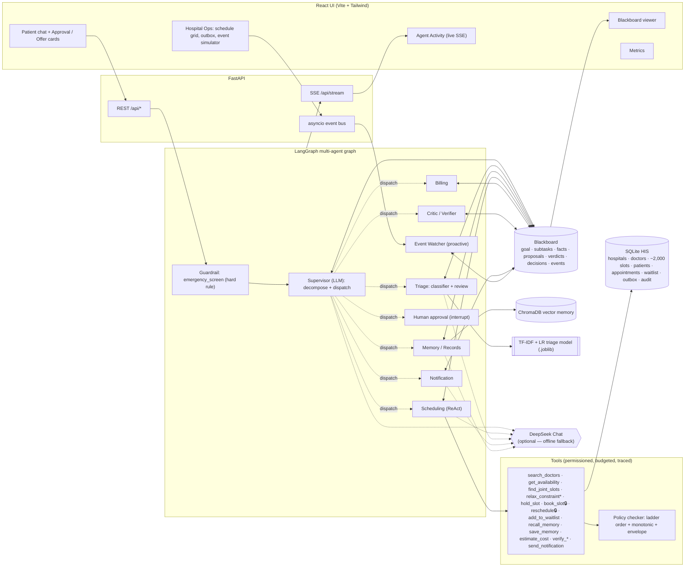
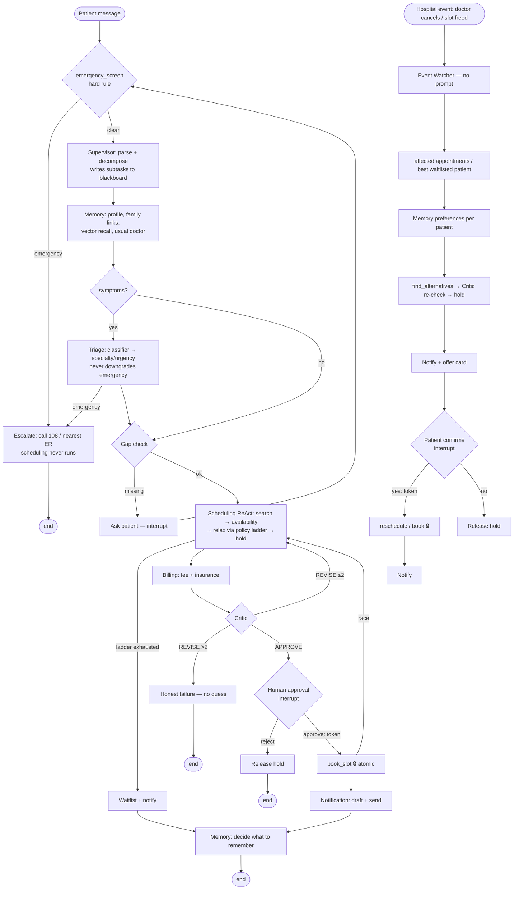

# Hospital Agent OS

**A multi-agent hospital appointment system:** a Supervisor decomposes goals onto a blackboard; specialist agents choose their own tools, remember patients, critique their own proposals, plan multi-person requests, and react to hospital events with no user prompt. Every write is gated by a human.

> **Free to think, gated to act. The agent is permitted to fail — never to invent.**

Agentic AI course project (CSE, AI & Analytics). Built with LangGraph, FastAPI, SSE, React + Vite + Tailwind, SQLite, ChromaDB and scikit-learn. LLM: DeepSeek Chat (OpenAI-compatible), with a full **offline mode** that needs no LLM.

---

## 1. Quick start

```bash
./run.sh            # first run: venv + deps + train model + seed data, then serves UI+API on http://localhost:8000
```
Windows: `run.bat`. The built UI is committed (`frontend/dist`), so **Node is not needed to run the demo**.

| Command | What it does |
|---|---|
| `./run.sh` | start the backend; it serves the React UI at **http://localhost:8000** |
| `./run.sh dev` | backend with `--reload` + Vite dev server on :5173 (needs Node 18+) |
| `./run.sh test` | `pytest` (48 tests) + the 18-scenario runner → `submission/test_results.{md,csv,json}` |
| `./run.sh reset` | reseed the demo data to its known state (the UI's **Reset demo** button does the same) |
| `./run.sh cli --patient P001` | interactive CLI with the original `[agent] message` trace style |
| `./run.sh shots` | Playwright walkthrough → 35 numbered screenshots in `submission/screenshots/` |

Manual equivalents:
```bash
python -m venv .venv && . .venv/bin/activate && pip install -r requirements.txt
python -m scripts.train_triage        # dataset + model + metrics + confusion matrix
python -m scripts.seed                # SQLite + CSV export + vector memory index
uvicorn backend.api.main:app --port 8000
python -m pytest -q && python -m scripts.run_scenarios
python -m backend.cli --patient P001  # or --scenario 10, --event cancel
```

### Environment variables (`.env`, see `.env.example`)
| Var | Default | Meaning |
|---|---|---|
| `DEEPSEEK_API_KEY` | — | without it the system runs **offline** automatically |
| `DEEPSEEK_BASE_URL` / `DEEPSEEK_MODEL` | `https://api.deepseek.com` / `deepseek-chat` | OpenAI-compatible endpoint |
| `DEMO_OFFLINE` | `0` | `1` = force offline (deterministic planner, same agents/tools/trace) |
| `LLM_TIMEOUT` | `25` | seconds before an LLM step falls back to offline logic (marked `fallback` in the trace) |
| `HOLD_TTL_SECONDS` / `PROACTIVE_HOLD_TTL_SECONDS` | `300` / `900` | soft-hold TTLs |
| `EMBEDDINGS` | `auto` | `auto` uses MiniLM if `sentence-transformers` is installed, otherwise a local hashing embedder |

Optional extras: `pip install -r requirements-optional.txt` (MiniLM embeddings, Python Playwright).

---

## 2. What makes it *agentic* (not a workflow)

| Capability | Where | How it shows in the UI |
|---|---|---|
| **Goal decomposition** (Unit 4) | `agents/supervisor.py` | Blackboard tab: subtasks, owners, dependencies, status |
| **Bounded autonomy (ReAct)** | `agents/scheduling.py` | Agent Activity: each `tool_call` with the agent's own **why** |
| **Long-term memory** (Unit 3) | `agents/memory.py`, `core/vector_memory.py` | `memory hit` rows; "Why this slot: your usual doctor · evening…" |
| **Reflection** | `agents/critic.py` | **Inject fault** toggle → Critic `REVISE` with reasons → corrected proposal |
| **Multi-goal planning** | supervisor + `find_joint_slots` | one combined proposal for patient + mother, one approval |
| **Proactive / event-driven** | `agents/event_watcher.py`, `core/events.py` | Hospital Ops → *Doctor cancels block* → offers appear with no prompt |
| **Human-in-the-loop** | LangGraph `interrupt()` | Approve / Reject card; proactive offers need *Confirm* |
| **Safety** | `core/guardrails.py`, `tools/policy.py`, gated tools | emergency banner; policy rejections; `BLOCKED` gate events |

---

## 3. Architecture

### Block diagram


### Request flow


### Agents and their tools
| Agent | Role | Tools (enforced by `tools/registry.py`) |
|---|---|---|
| **Supervisor** (LLM) | parse + decompose the goal into subtasks, dispatch the next ready subtask, re-plan on REVISE / race / clarification, decide when done | blackboard read/write, dispatch |
| **Triage** | symptoms → specialty + urgency | `emergency_screen` (always first), `classify_symptoms` (ML), `get_specialty_info` |
| **Scheduling** (ReAct) | find + propose the best slot; re-plan when blocked | `search_doctors`, `get_availability`, `find_joint_slots`, `relax_constraint`, `hold_slot`, `release_hold`, `book_slot` 🔒, `book_joint` 🔒, `reschedule_appointment` 🔒, `add_to_waitlist` |
| **Memory / Records** | preferences, usual doctor, family links; decides what to remember | `recall_memory` (vector), `get_visit_history`, `get_patient_profile`, `save_memory` |
| **Billing** | fees, coverage, out-of-pocket | `get_fee`, `check_insurance`, `estimate_cost`, `get_patient_appointments` |
| **Critic** | verifies every proposal before the patient sees it → `APPROVE` / `REVISE(reasons)` | `verify_ids_exist`, `verify_slot_free`, `compare_to_original_request` |
| **Notification** | LLM drafts (fact-checked), tool delivers to the outbox | `send_notification` |
| **Event Watcher** | wakes on events, re-homes patients, fills slots from the waitlist | `get_affected_appointments`, `find_alternatives`, `offer_to_waitlist`, `hold_slot`, `send_notification`, + gated reschedule/book after confirmation |

🔒 = **gated**: refuses to write without an approval token that only the human-approval step can mint.

### Blackboard (Unit 4)
`core/blackboard.py`: a typed Pydantic workspace with `goal`, `subtasks[]` (id, owner, status, depends_on, goal_ref, params, result), `facts`, `proposals[]`, `critic_verdicts[]`, `decisions[]` and `events[]`. Every write is recorded as `{agent, ts, section, content}`, persisted to SQLite (`blackboard_writes`) and streamed as a trace event. Agents never call each other: they read and write the board, and the Supervisor dispatches. A blackboard can be rebuilt by replaying its writes.

### Memory (Unit 3)
`core/vector_memory.py`: ChromaDB (persistent, cosine), with a numpy fallback. The embedder is MiniLM when available, otherwise a deterministic hashing embedder (word n-grams with domain synonyms plus char n-grams). It holds about 300 seeded episodic and preference memories from visit history. The memory agent merges vector hits with structured records (profile, most-seen doctor) and saves new memories after each run.

### Relaxation ladder (policy-checked)
`widen_time → widen_area → allow_tele → next_day → (exhausted) waitlist`. Steps are monotonic. Ineffective steps are skipped automatically and don't count; maximum 4. `relax_constraint` rejects any other step and names the allowed one. `get_availability` rejects searches outside the current envelope. Every applied relaxation must appear in the proposal's disclosures, or the Critic says REVISE.

---

## 4. Safety guarantees
1. **Emergency first.** `emergency_screen` (regex, EN + Hinglish) runs on every message, including clarification answers, before any agent. On an emergency the system escalates (call 108 / nearest ER) and scheduling never runs. The ML classifier can only *add* emergencies, never remove one.
2. **Human approval for every write.** `book_slot`, `book_joint` and `reschedule_appointment` need a token minted only after a LangGraph `interrupt()` is approved. An LLM that calls them directly gets `BLOCKED` (tested).
3. **Zero fabrication.** Proposals are assembled from tool results. The ReAct loop rejects slot ids that no tool returned. The Critic re-checks every id, date, time, mode and fee against the DB.
4. **Disclosure.** Every relaxation is shown to the patient ("What I changed from your request").
5. **Limits.** 15 tool calls per agent per run, 2 critic loops, 4 relaxations, 2 clarifications and a global timeout. Hitting any limit produces an honest fallback.
6. **Race-safe booking.** Booking is one conditional `UPDATE … WHERE status='free' OR held-by-me` in a transaction. A lost race is re-planned (the next best slot goes back to the patient for approval). Joint bookings are all-or-nothing.

---

## 5. Data and model
* `scripts/seed.py` (fixed seed 42, dates relative to **today**): 5 hospitals + 1 clinic in 6 Pune localities, 40 doctors, 8 specialties, **2,035 slots over 14 days** (about 40% booked), 100 patients + guest, family links, 4 insurance plans + self-pay, visit history, waitlist and memories. CSVs are exported to `data/`. Demo fixtures make every scenario deterministic on any day. The server reseeds automatically when the date changes.
* `scripts/train_triage.py` builds `data/triage_dataset.csv` (2,800 sentences, EN + Hinglish) and trains **TF-IDF (word 1–2 + char 2–5) + Logistic Regression**, with separate heads for specialty and urgency. It writes `models/triage_classifier.joblib`, `models/metrics.json` and `models/confusion_matrix.png`.

| Split | Specialty acc / macro-F1 | Urgency acc / macro-F1 | Emergency recall |
|---|---|---|---|
| Standard 80/20 | 0.970 / 0.970 | 0.998 / 0.998 | 1.000 |
| Unseen phrasings (group split) | 0.634 / 0.620 | 0.707 / 0.663 | — |

The unseen-phrase numbers are reported on purpose: template data inflates in-distribution accuracy. That is why triage refuses to guess below 45% confidence (it asks instead), and why emergencies use a hard rule.

---

## 6. Scenarios (all pass — `submission/test_results.md`)
S01 direct booking · S02 clarification loop · S03 widen time · S04 widen area (time step skipped) · S05 teleconsult · S06 emergency · S07 waitlist after the full ladder · S08 memory "usual doctor next week" · S09 critic catches an injected fault · S10 multi-goal family booking · S11 doctor cancels a block (proactive) · S12 slot freed → waitlist fill · S13 billing with insurance · S14 Hinglish symptoms · S15 offline mode · S16 booking race → re-plan · S17 patient rejects · S18 Hinglish emergency.

S01–S07 re-specify the original CLI's 7 scenarios; see `DECISIONS.md` D-01.

## 7. Project layout
```
backend/
  agents/   supervisor.py triage.py scheduling.py memory.py billing.py critic.py notification.py event_watcher.py
  tools/    registry.py policy.py doctors.py availability.py booking.py billing.py memory_tools.py notify.py verify.py triage_tools.py
  core/     graph.py blackboard.py state.py context.py events.py llm.py fallback_parser.py guardrails.py trace.py vector_memory.py runner.py
  db/       models.py session.py
  ml/       triage_data.py triage_model.py
  api/      main.py (REST + SSE + static UI) routes.py
  cli.py
frontend/   React + Vite + TS + Tailwind (src/components/*), built to frontend/dist
scripts/    seed.py train_triage.py run_scenarios.py capture_screenshots.py
data/ models/ tests/ submission/ legacy/
```

## 8. Known limitations
* **The online (DeepSeek) path has not run against the real API in this build environment** (no key, host blocked). It is tested end to end with a scripted fake tool-calling LLM (`tests/test_react_loop.py`), including misbehaviour cases. Do one live check with your key before the jury.
* The offline embedder is lexical (hashing n-grams with synonyms), not semantic. Install `sentence-transformers` for real MiniLM embeddings.
* Multi-goal joint search uses the deterministic `find_joint_slots` planner in both modes. The LLM's role there is the decomposition.
* In-process state (LangGraph `InMemorySaver`, run contexts) means a server restart drops conversations that are mid-approval. Blackboards and the audit trail persist in SQLite.
* Mock HIS: no real SMS/email, no payments, no authentication.
